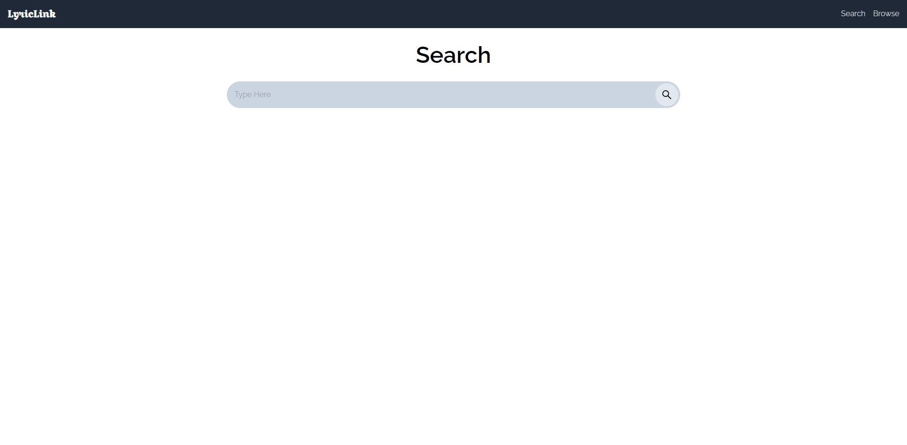
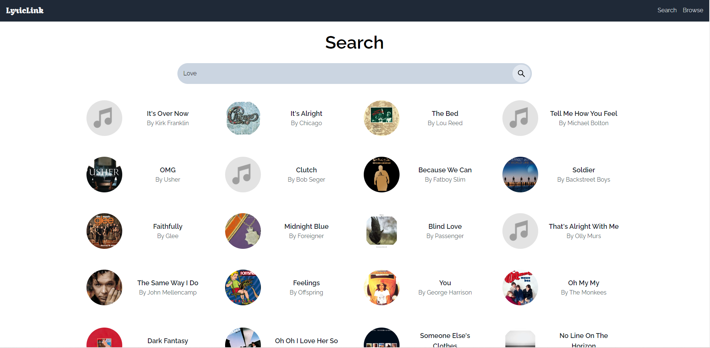
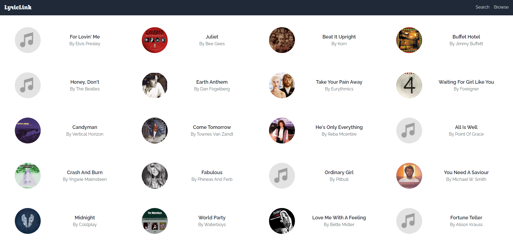
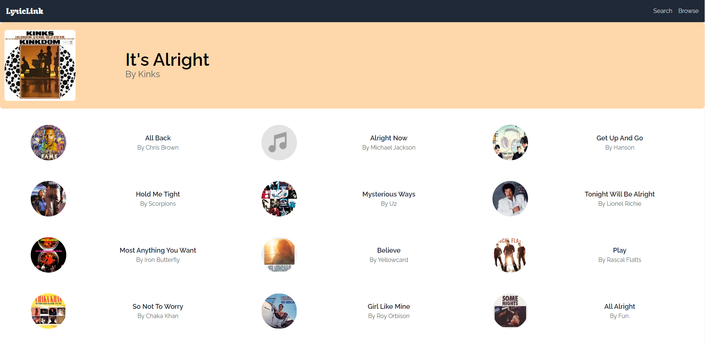

# LyricLink: Song Recommender

LyricLink finds songs with similar lyrics. Search by song title, artist or lyric keywords, open any song, and get 20 recommendations ranked by lyric similarity. It also has a Browse page (shuffle + infinite scroll), a Favourites page and a dark mode.

## Table of Contents

- [Technologies Used](#technologies-used)
- [How It Works](#how-it-works)
- [Project Structure](#project-structure)
- [Getting Started](#getting-started)
- [Configuration](#configuration)
- [API](#api)
- [Rebuilding the Data](#rebuilding-the-data)
- [Tests and Linting](#tests-and-linting)
- [Deploying the Frontend on Vercel](#deploying-the-frontend-on-vercel)
- [Screenshots for Reference](#screenshots-for-reference)

## Technologies Used

- **Frontend:** React 18, Vite, Tailwind CSS, React Router, Vitest + Testing Library
- **Backend:** Python 3.11, FastAPI, Uvicorn, scikit-learn (TF-IDF), RapidFuzz
- **Deployment:** Docker (nginx serves the built frontend and proxies `/api` to the backend)
- **Data:** the Kaggle "Spotify Million Song Dataset", tracked with Git LFS

## How It Works

1. **Data:** `python_backend/build_index.py` reads the CSV, takes a seeded sample of 20,000 songs (`random_state=42`) and gives each song a stable integer `id`.
2. **Similarity:** lyrics are cleaned, tokenised and stemmed, then turned into TF-IDF vectors. For every song the 20 most similar songs are stored (cosine similarity). Covers, near-duplicate lyrics and repeated titles are removed, and songs by the same artist get a small boost.
3. **Search:** a query is matched fuzzily against titles and artists, and against lyrics using the same TF-IDF vectorizer. Results are shown with a lyric snippet.
4. **Recommendations:** opening a song (`/song/:id`) shows its stored neighbours with a match percentage.

Songs are always identified by `id`, never by title, because many titles are shared by several artists.

## Project Structure

- **[python_backend/](python_backend/)**
  - [main.py](python_backend/main.py): FastAPI application
  - [build_index.py](python_backend/build_index.py): builds `songs.pkl`, `lyrics.pkl` and `index.pkl` from the CSV
  - [text_utils.py](python_backend/text_utils.py): text cleaning and tokenising shared by the build script and the API
  - [tests/](python_backend/tests/): API tests (pytest)
  - [requirements.txt](python_backend/requirements.txt) (runtime), [requirements-build.txt](python_backend/requirements-build.txt), [requirements-dev.txt](python_backend/requirements-dev.txt)
  - `ml_recommend/spotify_millsongdata.csv`: raw dataset (Git LFS)
- **[frontend/](frontend/)**: Vite + React app (`src/pages`, `src/components`, `src/hooks`, `src/api.js`), `nginx.conf` for the production image, `vercel.json` for Vercel
- **[Dockerfile](Dockerfile)** and **[docker-compose.yaml](docker-compose.yaml)**: one multi-stage Dockerfile with `backend`, `frontend-build` and `frontend` targets
- **[.github/workflows/ci.yml](.github/workflows/ci.yml)**: lint, test and build on every pull request
- **[Makefile](Makefile)**: shortcuts for the commands below

## Getting Started

The data files are stored with [Git LFS](https://git-lfs.com/). Install it **before cloning**:

```bash
git lfs install
git clone https://github.com/prashant-singh-2001/song_recommender.git
cd song_recommender
```

### With Docker (recommended)

```bash
docker compose up --build
```

- App: http://localhost:3000 (nginx; API calls go through `/api`)
- API: http://localhost:8000 (docs at http://localhost:8000/docs)

If port 3000 is already in use, run `FRONTEND_PORT=3001 docker compose up --build`.

### Without Docker

You need Python 3.11 and Node 24.

```bash
# terminal 1: API on http://localhost:8000
cd python_backend
pip install -r requirements.txt
python -m uvicorn main:app --reload --port 8000

# terminal 2: app on http://localhost:3000
cd frontend
npm install
npm run dev
```

`make dev-backend` and `make dev-frontend` run the same commands if you have `make`.

## Configuration

Copy [.env.example](.env.example) to `.env` to change any of these (all are optional):

| Variable | Used by | Purpose |
|---|---|---|
| `FRONTEND_PORT` | docker compose | Host port for the frontend (default 3000) |
| `CORS_ORIGINS` | backend | Comma-separated browser origins allowed to call the API directly |
| `VITE_API_URL` | frontend | Where the browser finds the API (default `http://localhost:8000`; the Docker image uses `/api`) |
| `LASTFM_API_KEY` | `build_index.py` | Fetch album covers that are not already known |

## API

| Endpoint | Description |
|---|---|
| `GET /health` | `{status, songs}` |
| `GET /search?q=` | Songs matching a title, artist or lyrics (`q` is 2-100 characters). Each hit has `id, artist, song, img_url, match, snippet` |
| `GET /songs/{id}` | One song, or 404 |
| `GET /songs/{id}/recommendations` | 20 similar songs with a `score` between 0 and 1 |
| `GET /browse?limit=&offset=&seed=` | A page of songs in a seeded random order: `{items, total, seed, next_offset}`. Reuse the returned `seed` to page without repeats |

## Rebuilding the Data

Run the build inside the backend image so the pickles match the runtime library versions:

```bash
make build-index
# or, without make:
docker compose build backend
docker run --rm -e LASTFM_API_KEY -v "$(pwd)/python_backend:/app/backend" -w /app/backend \
  song_recommender-backend sh -c "pip install -q -r requirements-build.txt && python build_index.py"
```

- The same seed gives the same sample and ids, so existing `/song/:id` links keep working.
- Covers already in `songs.pkl` are reused. Set `LASTFM_API_KEY` to fetch the rest (about 4 requests per second, cached in `covers_cache.json` so an interrupted run resumes). Songs without a cover show a placeholder.
- Commit the regenerated `*.pkl` files; Git LFS stores them.

## Tests and Linting

```bash
# backend (pytest + ruff)
cd python_backend && pip install -r requirements-dev.txt && ruff check . && pytest

# frontend (vitest + eslint)
cd frontend && npm ci && npm run lint && npm test -- --run
```

The tests need the real data files, so make sure Git LFS has fetched them (`git lfs pull`).

## Deploying the Frontend on Vercel

Vercel can host the static frontend only. In the Vercel project settings use:

- **Root Directory:** `frontend`
- **Framework Preset:** Vite (Build Command `npm run build`, Output Directory `dist`, no `docker compose` override)
- **Node.js Version:** 24.x
- **Environment variable** `VITE_API_URL`: the public URL of a hosted backend (otherwise search and browse have nothing to call)

## Screenshots for Reference

 </br>

### Landing Page

- **Find Your Jam** opens the Search page.
- **Discover New Hits** opens the Browse page.

<hr/>
<br/>
<br/>
 </br>

### Search Page

Type a song, artist or lyric keyword; results appear as you type (or press Enter).

<hr/>
<br/>
<br/>

 </br>

### Search Page with Results

Click a result to open its page and see similar songs.

<hr/>
<br/>
<br/>
 </br>

### Browse Page

Browse random songs from the database. Scroll for more, or press **Shuffle** for a new order.

<hr/>
<br/>
<br/>

 </br>

### Song Page

See recommendations for similar songs, favourite the song, or look it up on Spotify and YouTube.

> The screenshots were taken before the redesign (favourites, dark mode, match percentages) and may differ slightly.
